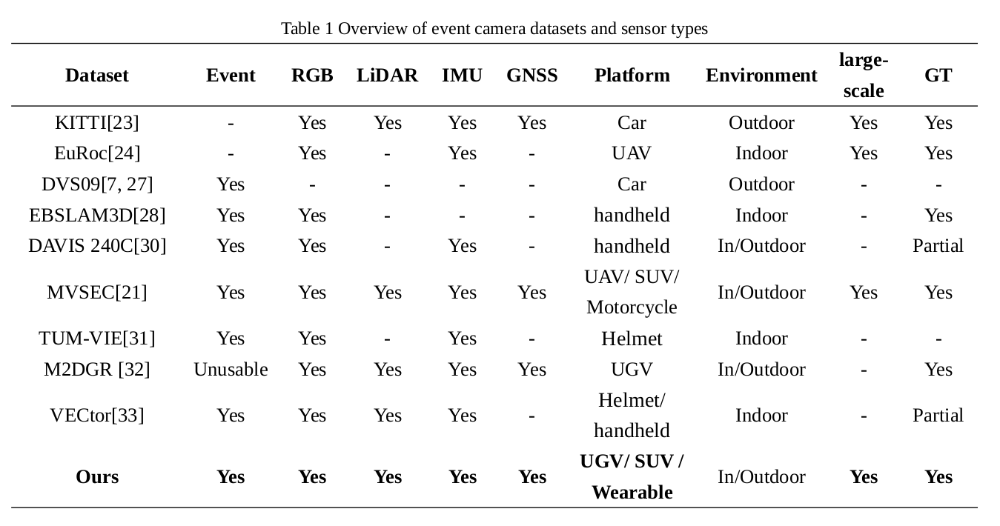
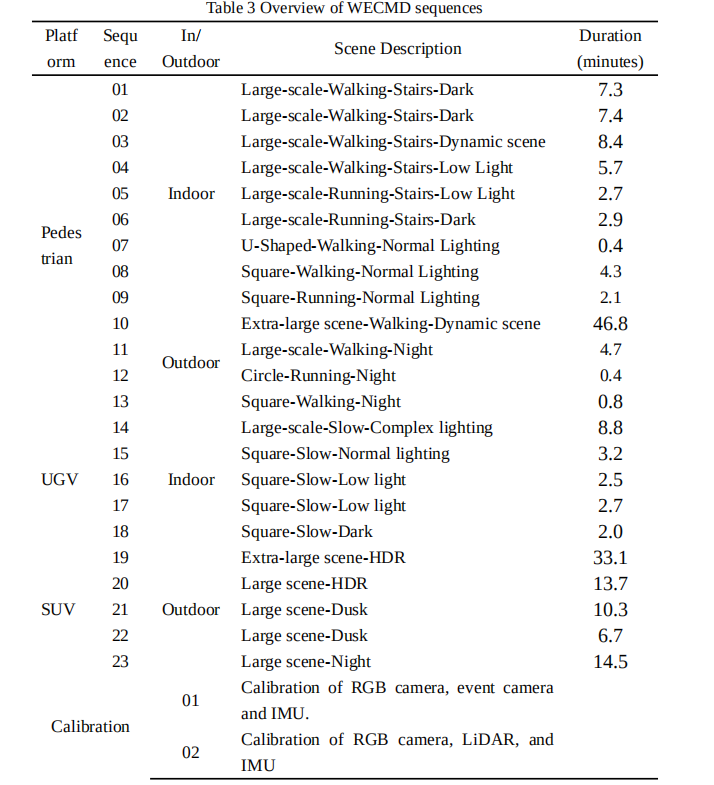
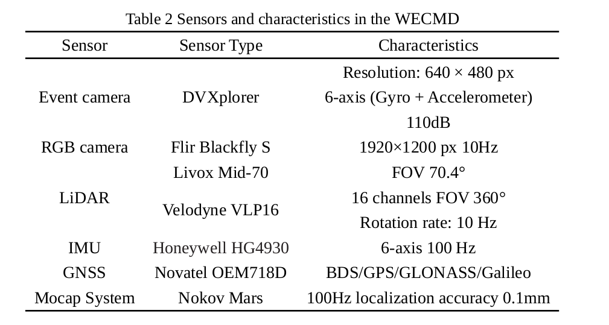
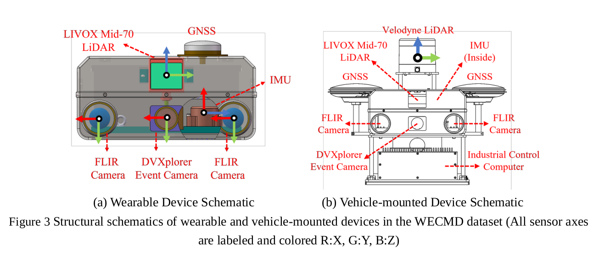

<!--
 * @Author: guoxl
 * @Date: 2024-10-20 19:51:26
 * @Email: guoxueli@whu.edu.cn 
 * @LastEditors:  
 * @LastEditTime: 2025-03-09 22:04:19
 * @Description: 
 * @version:  
-->

> 📢 **Notice on Dataset Download Links (Updated: 2025-07-18)**

Our dataset is currently hosted on Baidu Netdisk. Due to certain unavoidable technical limitations, some users—especially those accessing from outside mainland China—may occasionally encounter issues such as "link unavailable" or timeouts.

To address this, we’ve added an additional mirror link pointing to the same dataset. Both links have been tested and confirmed to work reliably from both domestic and international networks.

If you still experience issues accessing the files, feel free to reach out — we’ll do everything we can to assist you.

In parallel, we’re working on uploading the dataset to Google Drive and OneDrive. However, due to bandwidth constraints and file size, the process is slower than expected.

If you know of faster or more reliable alternatives for hosting large datasets, we’d be grateful if you could share them with us!

🙏 Seriously, we’re doing our best — please bear with us.
🙏 求求了求求了，可怜可怜孩子吧！We're just researchers with shaky Wi-Fi and big dreams.

# WECMD: A Multisensor Dataset for Wearable Event Cameras in the Age of Embodied Intelligence

In the context of the embodied intelligence era, pedestrian-wearable datasets effectively simulate scenarios that pose challenges for humanoid robots to navigate. However, there is still a significant lack of publicly available multi-sensor datasets specifically addressing the urgent and widespread localization needs of pedestrians. The unique dynamics of pedestrian movement further dictate that traditional RGB cameras and light detection and ranging (LiDAR) sensors are often inadequate for capturing their motion characteristics. Thus, given the high dynamic range, low latency, and immunity to motion blur that event cameras provide, there is an urgent need for datasets based on event cameras. To meet the need for multisensory data from wearable sensors, we have collected a comprehensive pedestrian-wearable dataset focused on large-scale indoor and outdoor environments with diverse motion dynamics and lighting conditions, primarily using an event camera. The dataset includes recordings from an event camera, two industrial RGB cameras, a solid-state LiDAR, a mechanical LiDAR, an inertial measurement unit (IMU), and a global navigation satellite system (GNSS) receiver. Each sensor underwent rigorous calibration to ensure accurate data collection. In indoor scenarios, ground truth was provided by a motion capture system, while in outdoor environments, the reference ground truth was obtained using high-precision GNSS+INS integrated post-processing software. Moreover, to accommodate other research teams interested in event cameras beyond wearable applications. This dataset also includes multisource fusion data collected from event cameras mounted on Sport Utility Vehicles (SUVs) and Unmanned Ground Vehicles (UGVs). The dataset is structured into 22 subsets, categorized by varying degrees of difficulty based on dynamic motion, lighting conditions, and scene texture complexity. This dataset represents the first large-scale, pedestrian-wearable event camera dataset, filling a critical gap in event-based vision research for pedestrian movement across diverse environments. We evaluated the dataset using state-of-the-art visual simultaneous localization and mapping (SLAM), LiDAR SLAM, event-based SLAM, and GNSS algorithms. Results indicate that existing SLAM and GNSS algorithms face significant challenges in several scenarios within this dataset, highlighting its benchmark use for future research in multi-sensor fusion and robust SLAM algorithm development. For the benefit of the research community, we have made the dataset and accompanying tools publicly available.

# Overview of event camera datasets and sensor types

# Sensor Types in the WECMD Dataset

# Video

# Download link🔗

## Baidu Netdisk：

https://pan.baidu.com/s/1qhGqweNSSlBixCNeexcsqw
code：ivw8

---

https://pan.baidu.com/s/1F_yhBwP0A8g7xbkP0TfUuQ

code： w21m

---

https://pan.baidu.com/s/1y5GS_V94mdMgYLA8aZpq1Q

code：whw9

## Google Drive

comming soon...

## Onedrive

comming soon...

## Dataset Quality Assurance and Quality Control (QA/QC)
To ensure the reliability and reproducibility of the WECMD dataset prior to its public release, a comprehensive Quality Assurance and Quality Control (QA/QC) procedure was implemented. This evaluation covered calibration accuracy, synchronization precision, sensor noise characteristics, and data integrity across all sensing modules, including the event camera, RGB cameras, LiDAR, and IMU.
(1) Intrinsic and Extrinsic Calibration Accuracy
The intrinsic calibration of the event camera was performed using the official DVXplorer calibration toolkit, achieving a root mean square (RMS) reprojection error of 0.316 px, which indicates sub-pixel precision. For extrinsic calibration between the event camera and its external IMU, the E2VID algorithm was used to reconstruct frame-based images from event streams, followed by spatial calibration via the Kalibr toolbox. The mean reprojection error was 0.253 px, with median 0.236 px and standard deviation 0.135 px. IMU residuals were 2.97×10⁻⁴ rad/s (gyroscope) and 3.59×10⁻³ m/s² (accelerometer), confirming low noise and consistent alignment. Cross-validation between the DV and Kalibr results showed negligible parameter deviation (<0.5%), verifying calibration stability and repeatability.
(2) Temporal Synchronization Validation
Both hardware and software synchronization were validated to confirm microsecond-level alignment. Using PPS-triggered hardware pulse tests and Ethernet communication with the synchronization board, the measured inter-sensor timing error remained consistently below 10 µs. Multi-level verification—including oscilloscope monitoring, software timestamp comparison, and absolute time consistency testing—confirmed that synchronization precision exceeds the standard requirements for multi-sensor fusion (<1 ms).
(3) IMU Noise and Stability Analysis
Static Allan variance tests and Kalibr outputs demonstrated that the tactical-grade IMU maintains bias stability within 0.02 °/s for gyroscopes and 0.004 m/s² for accelerometers. These values correspond to the residuals reported by Kalibr (2.97×10⁻⁴ rad/s and 3.59×10⁻³ m/s²), confirming low noise and high stability suitable for long-term motion estimation.
(4) Event Camera Noise Evaluation
According to the manufacturer’s specifications, the DVXplorer event camera exhibits a dynamic range of approximately 90–110 dB, enabling reliable operation from 0.3 to 100,000 lux illumination. Under static and uniform illumination conditions, 99.9% of pixels respond to 27.5% contrast (corresponding to ~90 dB dynamic range), and 50% of pixels respond to 80% contrast (approximately 110 dB). These characteristics demonstrate the system’s high contrast sensitivity—13% for 50% pixel activation and 27.5% for 99.9% activation—and ensure stable performance under extreme lighting variations. During static tests, inspection of recorded event streams under constant illumination showed that background activity was negligible, consistent with the manufacturer’s specified low spurious-event rate. The event threshold and bias calibration procedures were verified to produce stable event output, confirming reliable operation in both low-light and high-dynamic conditions.
(5) Multi-Sensor Spatial and Temporal Calibration
The WECMD sensing suite underwent comprehensive spatial–temporal calibration centered on the IMU reference frame. The extrinsic parameters between the IMU and dual RGB cameras were estimated using the Kalibr toolbox with AprilGrid patterns. The resulting reprojection errors were 0.166 px (cam0) and 0.191 px (cam1), indicating sub-pixel alignment accuracy. The estimated time offsets between the IMU and the two cameras were 0.0084 s and 0.0099 s, respectively, confirming millisecond-level temporal synchronization. The stereo baseline between the two cameras was 0.242 m.
The spatial transformation between the IMU and LiDAR was also calibrated, yielding the following parameters: Rotation (LiDAR→IMU) = (179.70°, 0.29°, −86.56°), Translation = (−0.119, 0.043, −0.151) m, and a time lag of −0.060 s (IMU relative to LiDAR). These results verify consistent geometric registration across all sensing modalities.
Together, these spatial and temporal calibration results confirm precise alignment among the LiDAR, IMU, and RGB sensors, ensuring the geometric consistency and synchronization required for accurate multi-sensor fusion and SLAM research

(6) Data Integrity and Completeness 
The continuity of the stereo RGB image streams was verified based on time-sequence file naming and internal acquisition logs. The data acquisition system automatically recorded frame indices and monitored potential frame losses during recording. Throughout all data collection sessions, no frame loss was detected in the stereo RGB images, and all frames maintained strict timestamp continuity. This confirms that the visual data were captured and stored without interruption or temporal drift, ensuring reliable synchronization with other sensor modalities.All ROS bag recordings were validated to ensure frame continuity and timestamp consistency. 
Collectively, these QA/QC results confirm that the WECMD dataset provides temporally synchronized, spatially calibrated, and noise-characterized multi-sensor data with verified integrity. The systematic evaluation ensures that WECMD meets the quality standards required for high-precision embodied perception, SLAM, and sensor fusion research.
